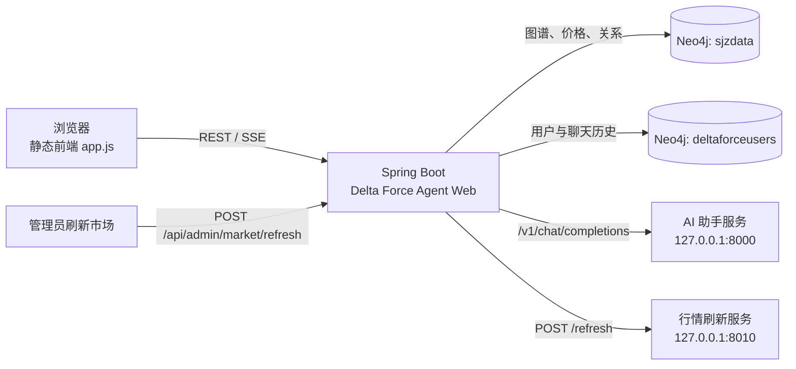

# Delta Force Agent Web

面向《三角洲行动》的智能助手 Web 应用。项目将武器、配件与装备图谱、市场行情、AI 对话和配装工具集中到一个 Spring Boot 应用中，提供市场查询、改枪台、卡战备、知识图谱和今日资讯等功能。

## 主要功能

- **智能对话**：通过本地 AI 助手服务进行流式对话，支持会话历史、ReAct 事件展示和改枪结果一键带入改枪台。
- **市场数据**：从 Neo4j 图谱节点读取当前购买价格、战备价值、涨跌幅、假账及 3/7/30 日行情。
- **改枪台**：根据 Neo4j 中的枪械、槽位与配件关系选择装配方案，并显示枪械、配件图片和价格。
- **卡战备**：基于枪械、头盔、护甲、胸挂和背包的价格与战备价值生成组合方案。
- **知识图谱**：检索节点、查看邻域关系，并提供受限的只读 Cypher 查询。
- **今日资讯**：展示地图信息和 AI 改枪推荐；推荐中的枪械、配件会自动匹配图片。
- **账号与会话**：JWT 登录鉴权；用户、聊天会话与历史消息独立存储在 Neo4j 的用户库中。

## 架构



### 数据流

1. 浏览器只访问 Spring Boot 的 `/api/**` 接口，静态页面由同一应用提供。
2. 市场、改枪台、卡战备与简易改枪推荐统一从 `sjzdata` 查询行情节点属性。
3. 后台“刷新市场”是唯一保留的 `8010` 调用；刷新服务应将新行情同步回 Neo4j。
4. 聊天请求由 Spring Boot 代理至 AI 助手服务，登录用户的会话与消息写入 `deltaforceusers`。

## 技术栈

- Java 8、Spring Boot 2.7
- Maven
- Neo4j Java Driver
- 原生 HTML / CSS / JavaScript 单页前端
- SSE 流式响应
- JWT 鉴权

## 目录说明

```text
src/main/java/                 Spring Boot 接口、服务与配置
src/main/resources/static/     前端页面、样式、脚本及图片资源
  attachment-images/           配件图片
  firearm-images/              枪械图片
src/main/resources/data/       枪械、配件基础数据
src/main/resources/application.yml
                               可提交的默认配置模板
src/main/resources/application-local.yml
                               本地私密配置（已被 Git 忽略）
```

## 运行前准备

1. 安装 JDK 8 或兼容版本、Maven 和 Neo4j。
2. 确保 Neo4j 中存在：
   - 图谱与价格库：`sjzdata`
   - 用户与聊天记录库：`deltaforceusers`
3. 在 `src/main/resources/application-local.yml` 配置本机 Neo4j 凭据；不要将该文件或真实密码提交到 Git。
4. 若需要智能对话，启动 AI 助手服务，默认地址为 `http://127.0.0.1:8000`。
5. 若需要从后台刷新行情，启动刷新服务，默认地址为 `http://127.0.0.1:8010`。

## 启动

编译：

```powershell
mvn -s .mvn\settings.xml -DskipTests compile
```

开发运行：

```powershell
mvn -s .mvn\settings.xml spring-boot:run
```

打包运行：

```powershell
mvn -s .mvn\settings.xml -DskipTests package
java -jar target\delta-force-agent-web-0.1.0.jar
```

启动后访问：<http://127.0.0.1:8080/>

## 主要接口

| 功能 | 接口 |
|---|---|
| 服务健康检查 | `GET /api/health` |
| 市场数据 | `GET /api/market/items?keyword=&type=&limit=100` |
| 后台刷新行情 | `POST /api/admin/market/refresh` |
| 改枪台枪械列表 | `GET /api/gun-modifier/firearms` |
| 改枪台枪械详情 | `GET /api/gun-modifier/firearms/{firearmId}` |
| 卡战备方案 | `POST /api/readiness/plans` |
| 知识图谱搜索 | `GET /api/knowledge/search` |
| 图谱邻域 | `GET /api/knowledge/neighborhood` |
| 只读 Cypher 查询 | `POST /api/knowledge/query` |
| 流式智能对话 | `POST /api/chat/stream` |
| 注册与登录 | `POST /api/auth/register`、`POST /api/auth/login` |
| 会话管理 | `/api/chat/sessions/**` |

## 行情节点属性

`sjzdata` 中的枪械、配件和装备节点可提供以下属性：

| Neo4j 属性 | API 字段 |
|---|---|
| 当前购买价格 | `currentPrice` |
| 战备价值 | `combatPrice` |
| 今日涨跌幅 | `todayChangePercent` |
| 当前假账数值 | `currentFakeAccount` |
| 假账数值占比 | `fakeAccountRatioPercent` |
| 3日价格 / 3日涨跌幅 | `price3d` / `change3dPercent` |
| 7日价格 / 7日涨跌幅 | `price7d` / `change7dPercent` |
| 30日价格 / 30日涨跌幅 | `price30d` / `change30dPercent` |

装备节点通过 `维修_装备类别`（或类型、类别等兼容字段）识别为头盔、护甲、胸挂和背包。
