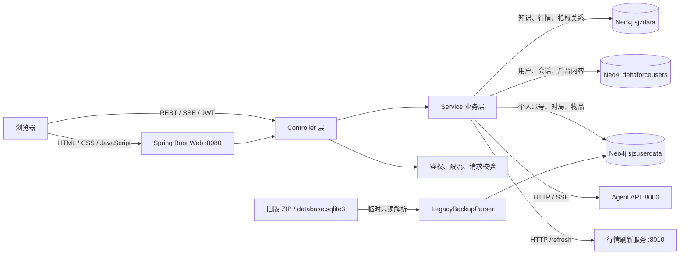

# Delta Force Agent Web

面向《三角洲行动》的个人智能助手与数据平台。项目由一个 Spring Boot 应用同时提供原生 Web 前端、REST API 和 SSE 流式接口，整合智能对话、市场行情、改枪、卡战备、知识图谱、个人战绩与管理后台。

项目以 Neo4j 作为唯一业务数据库。旧版数据中心 ZIP 中的 SQLite 文件仅在导入时临时解析，解析结果直接写入 Neo4j；项目不再使用 PostgreSQL、H2 或 Flyway。

## 主要能力

### 今日资讯

- 展示每日地图密码、资讯内容和 AI 改枪推荐。
- 今日资讯可以在未登录状态下查看。
- 管理员可以在独立后台维护内容并触发市场数据刷新。

### 智能对话

- 对接 OpenAI 兼容的 `/v1/chat/completions` 智能体接口。
- 同时支持普通 JSON 响应和 SSE 流式输出。
- 展示 ReAct 执行过程、工具调用、任务状态和调试信息。
- 保存会话、消息、执行事件与任务记录。
- 支持创建、归档、删除会话和取消任务。
- 可选把当前用户的个人战绩摘要预加载到智能体上下文。

### 市场、改枪与战备

- 从 Neo4j 查询枪械、配件、装备、价格和图谱关系。
- 支持关键词、类型和数量限制的市场检索。
- 根据枪械槽位选择兼容配件并计算价格与战备价值。
- 根据目标战备值生成枪械和装备组合方案。
- 管理员可以调用独立行情服务刷新市场数据。

### 知识图谱

- 搜索枪械、配件和装备实体。
- 查看实体的邻域节点与关系。
- 执行受限制的只读 Cypher 查询。
- 对查询类型、结果数量和执行时间进行限制。

### 个人数据中心

- 支持多个游戏账号的选择和管理。
- 导入本项目 JSON 数据，或兼容旧版 `dfdc_backup_*.zip`。
- 查询对局列表、单局详情、时间范围统计、趋势和物品汇总。
- 导出当前账号的完整 JSON 数据。
- 支持删除单个账号或清除当前用户全部战绩数据。
- 所有战绩数据按当前 JWT 用户隔离存储。

### 用户与管理后台

- 用户注册、登录、JWT 鉴权和 BCrypt 密码哈希。
- 管理员控制是否允许新用户注册。
- 管理用户、查看用户会话与消息。
- 查看允许访问的 Neo4j 数据库并执行受控查询。
- 支持通过环境变量在首次启动时创建管理员。

### 响应式前端

- 原生 HTML、CSS、JavaScript 单页界面，无 Node.js 构建步骤。
- 支持桌面端、平板和手机竖屏。
- 移动端优化智能对话的历史记录、执行过程和数据中心布局。
- 提供独立管理后台页面。

## 系统整体架构



### 运行时数据流

1. 浏览器加载 Spring Boot 内置的静态 SPA。
2. 前端通过 `/api/**` 调用 Controller，并在需要登录的请求中携带 Bearer JWT。
3. Controller 负责参数校验、身份要求和 HTTP 响应，Service 负责领域逻辑。
4. Neo4j Java Driver 根据业务类型连接不同数据库。
5. 智能对话由 `ChatProxyService` 转发给 Agent API；流式响应通过 SSE 返回浏览器。
6. 市场刷新由 `MarketDataService` 调用独立行情服务，常规查询直接读取 Neo4j。
7. 旧版 ZIP 导入时，SQLite 数据库只在临时目录中读取，完成后写入 `sjzuserdata` 并删除临时文件。

## Neo4j 数据架构

| 数据库 | 默认名称 | 主要数据 |
|---|---|---|
| 知识与行情库 | `sjzdata` | 枪械、配件、装备、价格、槽位和实体关系 |
| 用户与应用库 | `deltaforceusers` | 用户、管理员角色、会话、消息、任务、每日内容和注册开关 |
| 个人战绩库 | `sjzuserdata` | 游戏账号、对局、参战玩家、物品和统计数据 |

应用启动时会检查个人战绩库并创建必要约束与索引。如果 Neo4j 账号没有创建数据库的权限，需要提前创建这三个数据库。

Docker Compose 当前使用 `neo4j:5.26-enterprise`，因为项目需要 Neo4j 多数据库能力。`NEO4J_ACCEPT_LICENSE_AGREEMENT=eval` 只表示接受评估许可；正式商业部署前需要确认使用的 Neo4j 许可证符合实际场景。

## 代码架构

```text
DeltaForceAgentWeb/
├─ src/main/java/com/deltaforce/agentweb/
│  ├─ DeltaForceAgentWebApplication.java    Spring Boot 入口
│  ├─ config/                               运行配置与横切能力
│  │  ├─ AppProperties.java                 delta-force.* 配置映射
│  │  ├─ BackendConfig.java                 Neo4j、HTTP 客户端、CORS、线程池
│  │  ├─ JwtAuthenticationInterceptor.java  JWT 身份解析
│  │  ├─ RateLimitInterceptor.java          API 限流
│  │  ├─ SecurityHeadersFilter.java         安全响应头
│  │  ├─ RequestSizeFilter.java             请求大小保护
│  │  ├─ CorrelationIdFilter.java           请求关联 ID
│  │  ├─ Neo4jHealthIndicator.java          Actuator Neo4j 健康检查
│  │  ├─ StatsDatabaseInitializer.java      战绩库、约束和索引初始化
│  │  └─ AdminBootstrapRunner.java           初始管理员创建
│  ├─ controller/
│  │  ├─ ApiController.java                 通用、鉴权、聊天、知识与市场 API
│  │  ├─ DataCenterController.java          个人数据中心 API
│  │  ├─ AdminController.java               管理后台扩展 API
│  │  └─ GlobalExceptionHandler.java        统一异常响应
│  ├─ service/
│  │  ├─ ChatProxyService.java              Agent API 与 SSE 转发
│  │  ├─ ChatHistoryService.java            会话、消息和任务持久化
│  │  ├─ UserService.java                   用户、登录和管理员初始化
│  │  ├─ AdminService.java                  后台内容与注册控制
│  │  ├─ AdminNeo4jService.java             后台 Neo4j 查询控制
│  │  ├─ MarketDataService.java             行情查询与刷新
│  │  ├─ KnowledgeService.java              图谱搜索、邻域和只读查询
│  │  ├─ GunModifierService.java            改枪槽位与配件关系
│  │  ├─ GunsmithService.java               改枪推荐
│  │  ├─ ReadinessService.java              战备方案生成
│  │  ├─ Neo4jDataCenterService.java        个人战绩存储和统计
│  │  └─ LegacyBackupParser.java             旧 ZIP / SQLite 兼容解析
│  └─ model/                                请求、响应和领域模型
├─ src/main/resources/
│  ├─ static/                               前端页面、样式、脚本与图片
│  ├─ data/                                 枪械和配件基础 JSON
│  ├─ application.yml                       通用配置
│  ├─ application-dev.yml                   开发 profile
│  └─ application-prod.yml                  生产 profile
├─ src/test/java/                           单元、Controller、前端契约和集成测试
├─ Dockerfile                               多阶段容器构建
├─ compose.yml                              Web + Neo4j 编排
├─ .env.example                             Docker 环境变量模板
├─ pom.xml                                  Maven 依赖和构建插件
└─ README.md
```

### 分层职责

| 层级 | 职责 |
|---|---|
| `static` | 页面渲染、前端路由、交互、SSE 消费和移动端适配 |
| `controller` | HTTP 路由、参数校验、身份要求和响应格式 |
| `service` | 业务规则、Neo4j 查询、外部服务代理和数据转换 |
| `config` | Bean、属性映射、安全过滤、限流、健康检查和启动初始化 |
| `model` | API 请求、响应和领域对象 |

## 使用的技术栈

| 分类 | 技术 |
|---|---|
| 语言与运行时 | Java 17+，Docker 运行镜像使用 Eclipse Temurin 17 JRE |
| Web 后端 | Spring Boot 3.5.14、Spring MVC、Jakarta Validation |
| 实时输出 | Server-Sent Events（SSE） |
| 数据库 | Neo4j Enterprise，多数据库架构 |
| 数据访问 | Neo4j Java Driver 6.1.0 |
| 兼容导入 | SQLite JDBC 3.50.3.0，仅用于旧 ZIP 解析 |
| 鉴权 | JWT、BCrypt、Bearer Token |
| 运维 | Spring Boot Actuator、健康探针、结构化生产日志 |
| 前端 | 原生 HTML5、CSS3、JavaScript、SVG、Web App Manifest |
| 构建 | Maven 3.9+、Maven Enforcer、Spring Boot Maven Plugin |
| 测试 | JUnit 5、Spring Boot Test、MockMvc、Mockito、JaCoCo |
| 容器 | Docker、Docker Compose、多阶段 Dockerfile |

## 配置文件介绍

### `src/main/resources/application.yml`

所有环境共享的主配置：

- Web 端口、压缩、优雅关闭和请求头限制。
- Multipart 上传上限和异步请求超时。
- Agent API、行情服务和 Neo4j 连接参数。
- JWT、CORS、BCrypt、HTTPS 和管理员初始化参数。
- API 限流阈值。
- Actuator 暴露范围与健康探针。
- 默认 profile 为 `dev`。

### `src/main/resources/application-dev.yml`

本地开发 profile。开发环境会在没有提供 `JWT_SECRET` 时生成临时随机密钥。

不要把个人 Neo4j 密码或其他真实密钥提交到此文件。推荐通过环境变量或未被 Git 跟踪的 `application-local.yml` 覆盖本机配置：

```powershell
java -jar target\delta-force-agent-web-1.0.0.jar --spring.profiles.active=dev,local
```

### `src/main/resources/application-prod.yml`

生产 profile：

- 开启 `require-https`。
- 使用 Logstash 格式的结构化控制台日志。

如果 TLS 在 Nginx、Traefik 或负载均衡器终止，代理必须正确传递 `X-Forwarded-Proto`；主配置已经启用 Spring Framework 的转发头处理。

### `.env.example` 与 `.env`

`.env.example` 是 Docker 部署模板。复制后填写真实值：

```bash
cp .env.example .env
chmod 600 .env
```

`.env` 已被 Git 忽略，不应提交到仓库或发送到公开位置。

### `compose.yml`

定义两个服务：

- `app`：从当前源码构建 Spring Boot 应用，使用 `prod` profile，对外暴露 `8080`。
- `neo4j`：运行 `neo4j:5.26-enterprise`，将数据库保存在 `neo4j-data` 命名卷。

Web 容器使用只读根文件系统、非 root 用户、`no-new-privileges` 和临时 `/tmp`。Neo4j 健康后才启动 Web 服务。

### `Dockerfile`

使用两阶段构建：

1. Maven + Temurin 17 阶段下载依赖并执行 `mvn verify`。
2. Temurin 17 JRE 阶段只复制最终 JAR，以非 root 用户运行。

### `pom.xml`

定义 Java/Spring Boot 版本、Neo4j 和 SQLite 驱动、测试依赖，以及 Maven Enforcer、Spring Boot 打包和 JaCoCo 报告插件。

## 环境变量

### 核心配置

| 变量 | 默认值 | 说明 |
|---|---|---|
| `SERVER_PORT` | `8080` | Web 服务端口 |
| `NEO4J_URI` | `bolt://localhost:7687` | Neo4j Bolt 地址；Compose 内覆盖为 `bolt://neo4j:7687` |
| `NEO4J_USER` | `neo4j` | Neo4j 用户名 |
| `NEO4J_PASSWORD` | 空 | Neo4j 密码，生产环境必须设置 |
| `NEO4J_KNOWLEDGE_DATABASE` | `sjzdata` | 知识与行情库 |
| `NEO4J_USER_DATABASE` | `deltaforceusers` | 用户与会话库 |
| `NEO4J_STATS_DATABASE` | `sjzuserdata` | 个人战绩库 |
| `FASTAPI_BASE_URL` | `http://127.0.0.1:8000` | Agent API 地址 |
| `FASTAPI_API_KEY` | 空 | Agent API Bearer Key |
| `FASTAPI_MODEL` | `DF_agent` | 传递给 Agent API 的模型名 |
| `FASTAPI_PRELOAD_PERSONAL_STATS` | `false` | 是否把个人战绩摘要预加载到智能体上下文 |
| `REALTIME_DATA_BASE_URL` | `http://127.0.0.1:8010` | 行情刷新服务地址 |

### 安全配置

| 变量 | 默认值 | 说明 |
|---|---|---|
| `JWT_SECRET` | 开发环境随机生成 | JWT 签名密钥；生产环境至少使用 48 位随机字符 |
| `JWT_TTL_SECONDS` | `3600` | JWT 有效期，单位秒 |
| `JWT_ISSUER` | `delta-force-agent-web` | JWT issuer |
| `JWT_AUDIENCE` | `delta-force-agent` | JWT audience |
| `BCRYPT_STRENGTH` | `12` | BCrypt cost |
| `CORS_ALLOWED_ORIGINS` | 本机 8080 地址 | 允许调用 API 的来源，多个值使用逗号分隔 |
| `REQUIRE_HTTPS` | `false` | 是否要求 HTTPS；`prod` profile 强制设为 `true` |
| `BOOTSTRAP_ADMIN_USERNAME` | 空 | 首次启动管理员用户名 |
| `BOOTSTRAP_ADMIN_PASSWORD` | 空 | 首次启动管理员密码，至少 16 位 |
| `KNOWLEDGE_QUERY_TIMEOUT_SECONDS` | `3` | 知识图谱查询超时 |

### 限流配置

| 变量 | 默认值 | 说明 |
|---|---|---|
| `RATE_LIMIT_AUTH` | `10` | 单来源每分钟鉴权请求数 |
| `RATE_LIMIT_CHAT` | `20` | 单来源每分钟对话请求数 |
| `RATE_LIMIT_KNOWLEDGE` | `30` | 单来源每分钟知识查询数 |
| `RATE_LIMIT_GENERAL` | `600` | 单来源每分钟通用 API 请求数 |

## 本地 Maven 构建与运行

### 环境要求

- JDK 17 或更高版本，推荐 JDK 21。
- Maven 3.9 或更高版本。
- 可访问的 Neo4j Enterprise 实例及三个数据库。
- 可选：Agent API，默认端口 `8000`。
- 可选：行情刷新服务，默认端口 `8010`。

### 配置本机环境

PowerShell 示例：

```powershell
$env:NEO4J_URI="bolt://127.0.0.1:7687"
$env:NEO4J_USER="neo4j"
$env:NEO4J_PASSWORD="your-password"
$env:NEO4J_KNOWLEDGE_DATABASE="sjzdata"
$env:NEO4J_USER_DATABASE="deltaforceusers"
$env:NEO4J_STATS_DATABASE="sjzuserdata"
$env:FASTAPI_BASE_URL="http://127.0.0.1:8000"
$env:REALTIME_DATA_BASE_URL="http://127.0.0.1:8010"
```

### 构建与测试

```powershell
mvn -s .mvn\settings.xml clean verify
```

构建产物：

```text
target/delta-force-agent-web-1.0.0.jar
```

### 启动

```powershell
java -jar target\delta-force-agent-web-1.0.0.jar --spring.profiles.active=dev
```

或者：

```powershell
mvn -s .mvn\settings.xml spring-boot:run
```

访问地址：

- Web：<http://127.0.0.1:8080/>
- 管理后台：<http://127.0.0.1:8080/admin.html>
- 应用健康检查：<http://127.0.0.1:8080/api/health>
- 存活探针：<http://127.0.0.1:8080/actuator/health/liveness>
- 就绪探针：<http://127.0.0.1:8080/actuator/health/readiness>

## Docker Compose 部署

### 1. 创建配置

```bash
cp .env.example .env
nano .env
chmod 600 .env
```

至少设置：

```dotenv
JWT_SECRET=replace-with-at-least-48-random-characters
BOOTSTRAP_ADMIN_USERNAME=site-admin
BOOTSTRAP_ADMIN_PASSWORD=replace-with-at-least-16-random-characters

NEO4J_PASSWORD=replace-with-a-strong-neo4j-password
NEO4J_KNOWLEDGE_DATABASE=sjzdata
NEO4J_USER_DATABASE=deltaforceusers
NEO4J_STATS_DATABASE=sjzuserdata

FASTAPI_BASE_URL=http://agent-service:8000
FASTAPI_API_KEY=
FASTAPI_MODEL=DF_agent
FASTAPI_PRELOAD_PERSONAL_STATS=false
REALTIME_DATA_BASE_URL=http://realtime-service:8010
CORS_ALLOWED_ORIGINS=https://your-domain.example
```

Linux Docker Engine 通常不能直接解析 `host.docker.internal`。如果 Agent API 和行情服务运行在宿主机，请配置容器可以访问的宿主机地址；如果它们也在 Compose 网络中，优先使用对应服务名。

### 2. 验证并启动

```bash
docker compose config --quiet
docker compose pull
docker compose up -d --build
```

### 3. 检查状态

```bash
docker compose ps
docker compose logs --tail=200 app
curl http://127.0.0.1:8080/actuator/health/readiness
```

### 4. 更新部署

```bash
git pull --ff-only
docker compose up -d --build
docker compose ps
```

停止服务但保留数据：

```bash
docker compose down
```

不要在需要保留数据时执行 `docker compose down -v`，该命令会删除 `neo4j-data` 数据卷。

注册关闭时，`POST /api/auth/register` 返回 `403`。

## 主要 API

| 模块 | 接口 |
|---|---|
| 健康检查 | `GET /api/health` |
| 注册状态 | `GET /api/auth/registration` |
| 注册与登录 | `POST /api/auth/register`、`POST /api/auth/login` |
| 今日资讯 | `GET /api/daily-content` |
| 市场数据 | `GET /api/market/items` |
| 智能对话 | `POST /api/chat`、`POST /api/chat/stream` |
| 会话与任务 | `/api/chat/sessions/**` |
| 改枪推荐 | `POST /api/gunsmith/recommend` |
| 改枪台 | `GET /api/gun-modifier/firearms/**` |
| 战备方案 | `POST /api/readiness/plans` |
| 知识图谱 | `/api/knowledge/**` |
| 个人数据中心 | `/api/data-center/**` |
| 管理后台 | `/api/admin/**` |

登录后请求使用：

```http
Authorization: Bearer <jwt-token>
```
