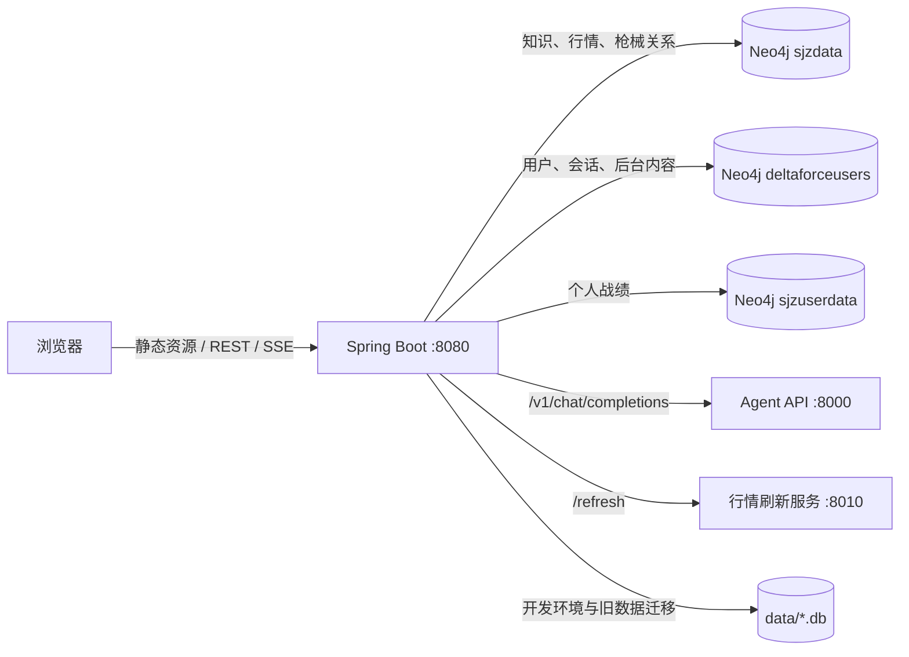

# Delta Force Agent Web

面向《三角洲行动》的个人智能助手与数据平台。项目使用 Spring Boot 提供统一的静态站点和 REST/SSE API，整合智能对话、市场行情、改枪、卡战备、知识图谱、个人战绩和管理后台。

## 功能概览

- **今日资讯**：无需登录即可查看每日地图密码、资讯和 AI 改枪推荐。
- **智能对话**：对接 Agent API v2，支持流式回答、会话历史、任务状态、ReAct 执行过程和日志导出。
- **市场数据**：查询枪械、配件和装备的当前价格、战备价值及多周期行情。
- **改枪台**：按枪械槽位选择配件，并统计价格、战备价值与装配结果。
- **卡战备**：组合枪械和装备，生成满足目标战备值的方案。
- **知识图谱**：搜索实体、查看邻域关系，并执行受限的只读 Cypher 查询。
- **个人数据中心**：导入 JSON 或旧版 ZIP 战绩，查看总览、对局、分析、趋势和物品统计。
- **管理后台**：管理用户、每日内容、数据库查询、市场刷新以及新用户注册开关。
- **响应式界面**：适配桌面、平板和手机竖屏；智能对话与数据中心提供专门的移动端布局。

除“今日资讯”、首页和登录页外，其余功能需要登录。新用户能否注册由管理员在管理后台开启或关闭。

## 技术栈

| 层级 | 技术 |
|---|---|
| 后端 | Java 17、Spring Boot 3.5.14、Spring MVC |
| 构建 | Maven 3.9+、Maven Wrapper 配置、JaCoCo |
| 前端 | 原生 HTML、CSS、JavaScript，单页路由 |
| 图数据库 | Neo4j Java Driver 6.1 |
| 关系数据库 | 开发环境 H2；生产环境 PostgreSQL；Flyway 迁移 |
| 兼容导入 | SQLite JDBC，用于读取旧版数据中心 ZIP |
| 鉴权 | JWT、BCrypt、接口限流 |
| 智能体 | OpenAI 兼容的 `/v1/chat/completions` 流式接口 |

## 系统结构



## 目录结构

```text
src/main/java/com/deltaforce/agentweb/
  config/          应用配置、鉴权、限流和数据库初始化
  controller/      REST 与 SSE 接口
  model/           请求、响应和领域模型
  service/         业务逻辑与外部服务代理
src/main/resources/
  static/          HTML、CSS、JavaScript、图标和图片资源
  data/            枪械与配件基础 JSON
  db/migration/    Flyway 数据库迁移
  application.yml  通用配置
  application-dev.yml / application-prod.yml
                   开发与生产环境配置
data/              本地 H2 运行数据，已被 Git 忽略
target/            Maven 构建产物，已被 Git 忽略
```

## 环境要求

- JDK 17 或更高版本（推荐 JDK 21）
- Maven 3.9 或更高版本
- Neo4j，且当前账号能够访问所配置的数据库
- 可选：Agent API 服务，默认 `http://127.0.0.1:8000`
- 可选：行情刷新服务，默认 `http://127.0.0.1:8010`

默认使用以下 Neo4j 数据库：

| 数据库 | 默认名称 | 作用 |
|---|---|---|
| 知识与行情 | `sjzdata` | 枪械、配件、装备、关系和市场价格 |
| 用户与会话 | `deltaforceusers` | 用户、JWT 关联、聊天记录和后台内容 |
| 个人战绩 | `sjzuserdata` | 账号、对局、队友、物品和统计数据 |

多数据库通常需要支持该能力的 Neo4j 版本和相应权限。应用会尝试初始化用户库与个人战绩库；若账号无建库权限，请提前创建数据库。

## 本地配置

开发配置默认使用文件型 H2：

```text
jdbc:h2:file:./data/delta-force-stats
```

首次启动后，`data/` 中的 `.db` 文件保存 Flyway 管理的本地关系数据和旧版个人战绩迁移状态。不要在服务运行时直接编辑，也不要提交到 Git。当前数据中心 API 的主存储是 Neo4j `sjzuserdata`，H2 主要用于开发环境、旧数据兼容和迁移。

推荐通过环境变量提供本机配置：

```powershell
$env:NEO4J_URI="bolt://127.0.0.1:7687"
$env:NEO4J_USER="neo4j"
$env:NEO4J_PASSWORD="your-password"
$env:NEO4J_KNOWLEDGE_DATABASE="sjzdata"
$env:NEO4J_USER_DATABASE="deltaforceusers"
$env:NEO4J_STATS_DATABASE="sjzuserdata"
$env:FASTAPI_BASE_URL="http://127.0.0.1:8000"
$env:REALTIME_DATA_BASE_URL="http://127.0.0.1:8010"
```

也可以创建未被 Git 跟踪的 `src/main/resources/application-local.yml`，启动时启用 `local` profile。不要在配置文件中提交真实密码、JWT 密钥或 API Key。

### 常用环境变量

| 变量 | 默认值 | 说明 |
|---|---|---|
| `SERVER_PORT` | `8080` | Web 服务端口 |
| `NEO4J_URI` | `bolt://localhost:7687` | Neo4j 地址 |
| `NEO4J_USER` / `NEO4J_PASSWORD` | `neo4j` / 空 | Neo4j 凭据 |
| `NEO4J_KNOWLEDGE_DATABASE` | `sjzdata` | 知识和行情数据库 |
| `NEO4J_USER_DATABASE` | `deltaforceusers` | 用户和会话数据库 |
| `NEO4J_STATS_DATABASE` | `sjzuserdata` | 个人战绩数据库 |
| `FASTAPI_BASE_URL` | `http://127.0.0.1:8000` | Agent API 地址 |
| `FASTAPI_API_KEY` | 空 | Agent API Bearer Key |
| `FASTAPI_MODEL` | `DF_agent` | 智能体模型名称 |
| `REALTIME_DATA_BASE_URL` | `http://127.0.0.1:8010` | 行情刷新服务地址 |
| `JWT_SECRET` | 开发环境随机生成 | JWT 签名密钥；生产环境必须设置 |
| `BOOTSTRAP_ADMIN_USERNAME` | 空 | 首次启动管理员账号 |
| `BOOTSTRAP_ADMIN_PASSWORD` | 空 | 首次启动管理员密码 |
| `CORS_ALLOWED_ORIGINS` | 本机 8080 来源 | 允许访问 API 的前端来源，逗号分隔 |
| `STATS_DATABASE_URL` | 开发 profile 使用 H2 | 关系数据库 JDBC URL |

## 使用 Maven 构建和启动

本项目无需 Docker。

### 1. 完整验证

```powershell
mvn -s .mvn\settings.xml clean verify
```

该命令会编译项目、运行测试、生成 JaCoCo 报告，并构建：

```text
target/delta-force-agent-web-1.0.0.jar
```

### 2. 开发方式启动

```powershell
mvn -s .mvn\settings.xml spring-boot:run
```

需要同时启用本地私密配置时：

```powershell
mvn -s .mvn\settings.xml spring-boot:run "-Dspring-boot.run.profiles=dev,local"
```

### 3. 使用 JAR 启动

```powershell
java -jar target\delta-force-agent-web-1.0.0.jar --spring.profiles.active=dev,local
```

启动后访问：

- Web：<http://127.0.0.1:8080/>
- 健康检查：<http://127.0.0.1:8080/api/health>
- Actuator 存活探针：<http://127.0.0.1:8080/actuator/health/liveness>
- Actuator 就绪探针：<http://127.0.0.1:8080/actuator/health/readiness>

## 初始管理员与注册开关

生产或首次部署时，可通过以下环境变量创建管理员：

```powershell
$env:BOOTSTRAP_ADMIN_USERNAME="admin"
$env:BOOTSTRAP_ADMIN_PASSWORD="replace-with-a-strong-password"
```

保留用户名 `admin` 会被兼容识别为管理员，并自动修复旧数据中的管理员角色。登录管理后台后，可在“注册控制”区域开启或关闭新用户注册：

- `GET /api/auth/registration`：公开读取注册状态；
- `PATCH /api/admin/registration`：管理员修改注册状态；
- 注册关闭时，`POST /api/auth/register` 返回 `403`。

## 个人数据中心导入

数据中心支持：

- 本项目导出的 `delta-force-agent-data-center-v1` JSON；
- 原 Delta Force Data Center 导出的 `dfdc_backup_*.zip`；
- 账号切换、战绩筛选、单局详情、表现分析、收益趋势和物品汇总；
- 当前账号全部数据的导出与删除。

JSON 最小结构：

```json
{
  "account": {
    "playerId": "游戏玩家 ID",
    "playerName": "玩家名"
  },
  "battles": [
    {
      "roomId": "对局 ID",
      "eventTime": "2026-07-21T12:00:00Z",
      "mapName": "零号大坝",
      "gameResult": 0,
      "playerKillCount": 3,
      "profitLoss": 1200000,
      "players": [],
      "items": []
    }
  ]
}
```

服务端忽略导入文件中的用户归属字段，并始终根据当前 JWT 用户绑定数据。WeGame Cookie 不会被上传到本站。

## 主要 API

| 模块 | 接口 |
|---|---|
| 健康检查 | `GET /api/health` |
| 注册状态 | `GET /api/auth/registration` |
| 注册 / 登录 | `POST /api/auth/register`、`POST /api/auth/login` |
| 智能对话 | `POST /api/chat`、`POST /api/chat/stream` |
| 会话与任务 | `/api/chat/sessions/**` |
| 市场数据 | `GET /api/market/items` |
| 改枪台 | `GET /api/gun-modifier/firearms`、`GET /api/gun-modifier/firearms/{firearmId}` |
| 卡战备 | `POST /api/readiness/plans` |
| 知识搜索 / 邻域 | `GET /api/knowledge/search`、`GET /api/knowledge/neighborhood` |
| 只读图谱查询 | `POST /api/knowledge/query` |
| 战绩账号 | `GET /api/data-center/accounts`、`POST /api/data-center/accounts/select` |
| 战绩导入 | `POST /api/data-center/import`、`POST /api/data-center/import/legacy-backup` |
| 战绩查询 | `GET /api/data-center/summary`、`GET /api/data-center/records` |
| 分析 / 趋势 / 物品 | `GET /api/data-center/analysis`、`GET /api/data-center/trends`、`GET /api/data-center/items` |
| 数据中心导出 | `GET /api/data-center/export` |
| 后台注册控制 | `PATCH /api/admin/registration` |
| 后台市场刷新 | `POST /api/admin/market/refresh` |

## 测试

只运行测试：

```powershell
mvn -s .mvn\settings.xml test
```

完整验证后，覆盖率报告位于：

```text
target/site/jacoco/index.html
```

测试覆盖鉴权限流、注册开关、管理员兼容、Agent API v2 请求与流式代理、数据中心接口和前端契约。

## 生产环境注意事项

使用 `prod` profile 时，至少应完成以下配置：

1. 设置高强度 `JWT_SECRET`、Neo4j 密码和管理员初始化密码。
2. 配置 PostgreSQL 的 `STATS_DATABASE_URL`、用户和密码。
3. 将 `CORS_ALLOWED_ORIGINS` 限制为实际部署域名。
4. 在反向代理或负载均衡器终止 TLS；生产 profile 默认要求 HTTPS。
5. 不对公网暴露 Neo4j、Agent API 和行情刷新服务。
6. 使用 `/actuator/health/liveness` 与 `/actuator/health/readiness` 配置探针。

## 常见问题

### Maven clean 无法删除 JAR

Windows 上正在运行的 Java 进程会锁定 JAR。先停止当前应用，再执行：

```powershell
mvn -s .mvn\settings.xml clean verify
```

### 页面能打开但模块没有数据

依次检查：

1. `/api/health` 是否返回 `ok: true`；
2. Neo4j 地址、密码和三个数据库名是否正确；
3. 当前账号是否已经登录；
4. Agent API 或行情刷新服务是否正在运行；
5. 浏览器开发者工具中的 Network 与 Console 是否存在错误。

### 注册按钮不可用

这是预期行为。管理员需要先在管理后台开启“新用户注册”。
